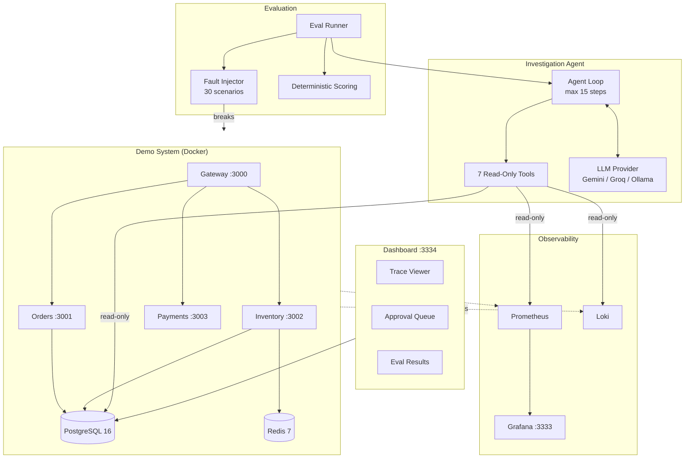

# RootCause: Autonomous Incident Investigation Agent

An autonomous AI agent that investigates production incidents across a demo microservice system, identifies root causes using 7 read-only tools, and proposes fixes for human approval — scored against 30 injected failures across 10 fault categories with a deterministic eval harness.

## Architecture



## Status

Work in progress. No eval has been run yet, so there are no results.

- 14 of 30 scenarios can be injected (`npm run fault -- list` shows which). The other 16 need
  fault actions that are not implemented: code faults shipped as a new service version,
  config restarts, Redis config changes and network faults.
- `query_logs` is still a stub, and the services do not ship logs anywhere yet.
- Nothing has been run against a live system. After changing `infra/postgres/init.sql`,
  recreate the database volume: `docker compose -f infra/docker-compose.yml down -v`.

## Results

None yet. This table is filled only from reports in `docs/results/`.

| Configuration | Accuracy | Partial | Steps (med) | Tokens (med) | Time (med) |
|---|---|---|---|---|---|

## Quickstart (Windows + Docker Desktop)

### Prerequisites
- Windows 10/11 with Docker Desktop running
- Node.js 20+ and npm
- Git

### Setup
```bash
git clone <this-repo>
cd rootcause
npm install
```

### Start the System
```bash
# Start all services, databases, and observability
npm run up

# Wait ~30 seconds for services to be ready, then seed data
npm run seed

# Start load generator (20 req/s)
npm run load
```

### Verify
- Services: http://localhost:3000/healthz
- Grafana: http://localhost:3333 (admin/admin)
- Prometheus: http://localhost:9090

### Investigate an Incident
```bash
# Inject a fault
npm run fault -- inject scenario-001

# Run the agent (requires GEMINI_API_KEY in .env)
npm run investigate -- --provider gemini

# View the dashboard
cd dashboard && npm run dev
# Open http://localhost:3334

# Revert the fault
npm run fault -- revert scenario-001
```

### Run the Full Eval
```bash
# Copy .env.example to .env and add your API key
cp .env.example .env

# Run all 30 scenarios (resumable if quota runs out)
npm run eval -- --provider gemini

# Compare configurations
npm run eval -- compare
```

## Safety Design

The agent is designed to be safe to run against real systems:

1. **Read-only tools**: Every investigation tool is read-only. The agent cannot modify services, databases, or configurations.
2. **SELECT-only SQL**: The `run_sql_readonly` tool accepts a single SELECT, then runs it as a PostgreSQL role with only SELECT privileges, inside a READ ONLY transaction, with a 3-second statement timeout and a 50-row limit. The role cannot read past investigation runs.
3. **Human approval**: The only "write" the agent can make is proposing a fix via `propose_fix`. A human must approve each proposal through the dashboard before any action is taken.
4. **Hard limits**: The agent is constrained by a 15-step maximum, a token budget, and a wall-clock timeout. If any limit is hit, it must submit whatever findings it has.
5. **Evidence-linked reports**: A report needs at least one evidence item, and each must reference a tool call from the current run. Otherwise it is rejected and the model must correct it. A report forced at a limit is kept but flagged as unverified.
6. **No ground truth leakage**: The agent is given a symptom-only alert. A test checks the scenario files for hints; it does not yet audit the running system's logs, metrics and labels.

## Project Structure

```
rootcause/
├── services/
│   ├── gateway/      # API gateway (Express + TypeScript)
│   ├── orders/       # Order management (PostgreSQL)
│   ├── inventory/    # Product catalog + stock (PostgreSQL + Redis)
│   └── payments/     # Mock payment processor
├── infra/            # Docker Compose, Prometheus, Loki, Grafana configs
├── loadgen/          # Traffic generator (configurable RPS)
├── faults/           # 30 fault scenarios (YAML) + injector CLI
├── agent/            # Investigation agent, tools, LLM providers
├── evals/            # Eval runner, scoring, reporting
├── dashboard/        # Next.js trace viewer + approval queue
├── scripts/          # Utility scripts (seed, deploy, alerts)
└── docs/             # Architecture docs, eval results, failure analysis
```

## Eval Methodology

- **30 scenarios** across 10 fault categories, 3 variants each
- **Deterministic scoring**: no LLM judge. Component + category must match ground truth.
- **Configurations supported**: any provider, full tool set vs `--no-deploys`, and `--baseline` (one LLM call that sees only the alert text, which measures how much the alert alone gives away)
- **No fake runs**: the runner injects the fault, waits for symptoms, runs the agent, reverts and checks health. It stops if a fault cannot be injected or an API key is missing.
- **Resumable**: free-tier quotas may interrupt a run; the runner picks up where it left off

## Known Limitations

- The demo system is small (4 services). Real production has hundreds.
- Fault injection is predetermined. Real incidents are emergent and compound.
- Free-tier LLM rate limits mean a full eval takes hours, possibly across multiple days.
- The agent has no memory across investigations. It cannot learn from past incidents.
- Network partition faults require Docker network manipulation which may not work on all setups.

## Tech Stack

TypeScript, Node.js 20+, Express, PostgreSQL 16, Redis 7, Docker, Prometheus, Loki, Grafana, Next.js 14, Tailwind CSS, pino, prom-client, zod, Gemini API, Groq API, Ollama

## License

MIT
