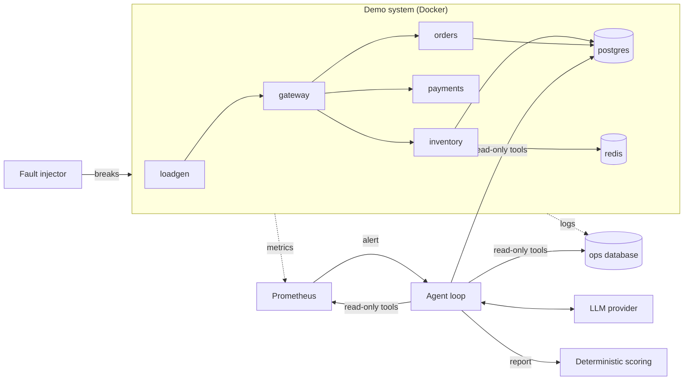

# RootCause: Autonomous Incident Investigation Agent

An LLM agent that is paged with a production alert, investigates a running microservice system with read-only tools, and reports the root cause with cited evidence. It is scored against 30 injected failures across 10 fault categories by a deterministic eval harness.

## Results

<!-- RESULTS:START -->
The eval is running. This section is filled from `docs/results/` when it finishes.
<!-- RESULTS:END -->

## How it works



1. **The demo system** is a small e-commerce backend: a gateway, three services, PostgreSQL and Redis. A load generator sends 20 requests per second, so there is always a healthy baseline to compare against.
2. **The fault injector** breaks it in one of 30 known ways: it deploys a release that carries a regression, changes a setting, drops an index, holds a database lock, runs a bad migration, or stops, freezes or disconnects a container.
3. **Prometheus** raises a symptom alert (error rate, latency, memory). The alert says what is wrong and where it shows, never why.
4. **The agent** receives that alert and investigates. The model decides which tool to call next and loops until it submits a report.
5. **The eval** compares the reported component and category with the ground truth. No LLM judge.

## The agent's tools

| Tool | What it reads |
|---|---|
| `list_alerts` | Alerts firing now |
| `service_health` | Container state, uptime, restarts, out-of-memory kills, memory, running version |
| `query_metrics` | A named metric over time (error rate, latency, memory, pool usage, event loop lag, and more) |
| `query_logs` | Service logs, grouped by message with counts and a sample stack trace |
| `recent_deploys` | Code, config and migration deploys, with how long ago each happened |
| `run_sql_readonly` | One SELECT against the application database or deploy history |
| `propose_fix` | Records a remediation for a human to approve. Executes nothing |
| `submit_report` | Ends the investigation with component, category, evidence and a suggested fix |

## Safety design

- **Read-only by construction.** No tool can change the system. `run_sql_readonly` accepts a single SELECT and runs it as a SELECT-only PostgreSQL role, inside a `READ ONLY` transaction, with a 3-second timeout and a 50-row limit.
- **Human approval for fixes.** `propose_fix` only writes a pending row. Nothing is executed by the agent.
- **Hard limits.** 15 steps, a token budget and a wall-clock timeout. At a limit the agent must report with what it has, and that report is flagged as unverified.
- **Evidence must be real.** A report needs at least one evidence item, and each must cite a tool call made in that run. Otherwise it is rejected and the model has to correct it.
- **No metrics query language, no shell.** The model picks metrics from an allowlist; it never writes PromQL or runs commands.

## Keeping the eval honest

A score only means something if the agent cannot cheat and the harness cannot flatter it.

- **Every fault is verified.** `npm run fault -- verify` injects each scenario and checks that its alert really fires, that the system recovers after revert, and that nothing the agent can read contains a giveaway word.
- **The agent cannot see ground truth.** Its database role cannot read past runs or reports. Tool output never includes environment variables or container labels.
- **Faults look like real life.** A code fault ships as a new version with a plausible commit message. Each scenario also records harmless recent deploys, so "blame the latest deploy" does not work.
- **Alerts state symptoms only.** The four alert rules are error rate, latency, service down and memory.
- **No invented results.** The eval starts the agent only after the expected alert is firing. If a fault cannot be injected, an API key is missing, or the model is unavailable, the run stops without scoring that scenario and can be resumed.
- **Deterministic scoring.** Correct means component and category both match. Partial means component only.

## Fault categories

Three scenarios each, on different services or tables:

| Category | Example |
|---|---|
| `bad_code_deploy` | A release throws a TypeError on one route |
| `memory_leak` | A release retains a buffer per request until the container is killed |
| `connection_pool_exhaustion` | A release leaks database connections on one code path |
| `slow_dependency` | A release burns CPU per request, or the card processor slows down |
| `wrong_config` | A service is pointed at a database or cache host that does not exist |
| `dependency_down` | A service container is stopped |
| `redis_unavailable` | Redis is stopped, frozen or cut off from the network |
| `dropped_index` | An index is dropped and a query scans a million rows |
| `long_running_lock` | A session holds a table or row lock open |
| `bad_migration` | A column is renamed, or added as NOT NULL with no default |

## Quickstart

Requires Docker Desktop (about 4 GB of memory for Docker), Node.js 20+ and a Gemini API key (the free tier works).

```bash
npm install
npm run build
cp .env.example .env    # then add GEMINI_API_KEY
npm run up              # builds and starts the system, including the load generator
npm run seed            # first time only: 5,000 products, 1,000,000 orders, deploy history
```

Investigate one incident by hand:

```bash
npm run fault -- inject scenario-002
npm run investigate -- --provider gemini   # once the alert is firing, about a minute later
npm run fault -- revert scenario-002
```

Run the eval:

```bash
npm run fault -- verify                     # optional: prove every fault works (about 75 minutes)
npm run eval -- --provider gemini --runId my-run
npm run eval -- --provider gemini --runId my-run --resume   # continue after a quota stop
npm run eval -- compare                     # table of every run in docs/results
```

Other eval options: `--scenario scenario-004` (repeatable), `--no-deploys` (hide the deploy history tool), `--baseline` (one LLM call that sees only the alert text), `--model <name>`.

Dashboard (traces, eval results, fix approvals):

```bash
npm run dev --workspace dashboard    # http://localhost:3334
```

## Project layout

```
services/    The four services and the load generator: one codebase, one image
infra/       Docker Compose, Prometheus rules, database schema
faults/      30 scenarios (YAML), the injector, and the verify command
agent/       Agent loop, tools, LLM providers, tracing
evals/       Eval runner, scoring, reports
dashboard/   Next.js trace viewer, eval results and approval queue
scripts/     up, down, seed
docs/        Architecture notes and eval results
```

## Limitations

- The demo system is four services. A real one has hundreds, and far noisier logs.
- Each incident has exactly one cause, injected on a healthy system. Real incidents overlap.
- The agent is given the list of fault categories. It classifies within a known taxonomy; it does not discover new kinds of failure.
- Three scenarios per category is a small sample, so per-category numbers are indicative only.
- LLM output varies between runs. Results here are from single runs, not averages.
- The agent has no memory between investigations.

## Tech stack

TypeScript, Node.js, Express, PostgreSQL 16, Redis 7, Docker Compose, Prometheus, Next.js 14, Tailwind CSS, zod, Gemini API. Groq and Ollama providers are in the code but have not been run against this system.

## License

MIT
